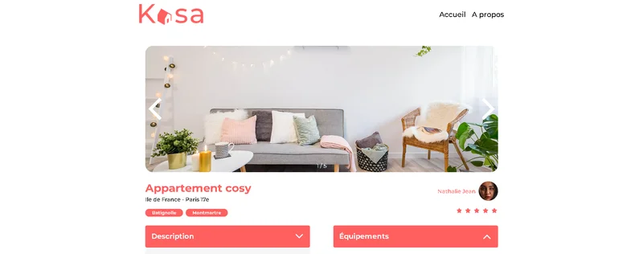

# Kasa : application de location de logements en React

Projet réalisé et validé dans le cadre de la formation **Développeur / testeur logiciel** d'OpenClassrooms (projet 8).

## Contexte

Kasa est une entreprise de location d'appartements entre particuliers. Son site, développé il y a plus de 10 ans en ASP.NET, fait l'objet d'une refonte complète vers une stack JavaScript : Node.js côté back-end et React côté front-end.

Dans le scénario du projet, j'interviens comme **développeur front-end freelance**. Ma mission : développer l'interface de la nouvelle application en React, à partir des maquettes du designer. Le back-end, fourni par la formation, est simulé par une API lancée avec Docker.

## Ce que j'ai réalisé

### Les pages

| Page | Contenu |
| --- | --- |
| Accueil | Bannière et galerie des logements, récupérés depuis l'API |
| Logement | Carrousel de photos, informations du logement et de l'hôte, note, menus déroulants Description et Équipements |
| À propos | Bannière et menus déroulants présentant les valeurs de Kasa |
| Erreur 404 | Affichée pour toute adresse inconnue ou tout identifiant de logement inexistant |

### Les composants

- **Banner** : un seul composant pour les bannières de l'accueil et de la page À propos, avec ou sans titre.
- **Card** : la carte d'un logement dans la galerie.
- **Collapse** : un menu déroulant animé, réutilisé sur les pages Logement et À propos.
- **Slideshow** : un carrousel qui boucle de la dernière à la première image, avec un compteur, et sans flèches quand le logement n'a qu'une photo.
- **Header** et **Footer**, communs à toutes les pages.

### Les choix techniques

- Une **application monopage** (SPA) en **React** avec **Vite** : **React Router** affiche chaque page sans recharger le site.
- **CSS Modules** pour isoler les styles de chaque composant.
- Une mise en page **responsive**, du mobile à l'ordinateur.

## Tests unitaires

Les trois composants qui portent le plus de logique sont couverts par **10 tests unitaires** avec **Vitest** et **React Testing Library** :

| Composant | Tests | Ce qui est vérifié |
| --- | --- | --- |
| Banner | 3 | Présence de l'image, présence du titre quand il est fourni, absence du titre sinon |
| Collapse | 2 | Contenu masqué à l'état fermé, affiché à l'ouverture |
| Slideshow | 5 | Image suivante, image précédente, rebouclage dans les deux sens, absence de flèches avec une seule image |

La couverture de code de ces trois composants est de **100 %** (instructions, branches, fonctions et lignes). Les pages et les autres composants ne font pas l'objet de tests unitaires.

## Compétences mobilisées

- Développement d'une application React à partir de maquettes
- Découpage de l'interface en composants réutilisables
- Navigation avec React Router et gestion des pages d'erreur
- Récupération de données depuis une API
- Tests unitaires de composants React et mesure de la couverture de code

## Lancer le projet

### Prérequis

- Docker
- Node.js

### Installation

Cloner le dépôt :

```
git clone https://github.com/AurelSan1989/P8-KASA.git
cd P8-KASA
```

Démarrer l'API (disponible sur http://localhost:8080) :

```
docker-compose up -d
```

Installer les dépendances du frontend, puis le démarrer :

```
cd frontend
npm install
npm run dev
```

L'adresse de l'application s'affiche dans le terminal (par défaut http://localhost:5173).

### Lancer les tests

Depuis le dossier `frontend` :

```
npx vitest run
```

Avec le rapport de couverture de code :

```
npx vitest run --coverage
```

La version remise pour l'évaluation est conservée sous le tag [`v1.0-soutenance`](https://github.com/AurelSan1989/P8-KASA/tree/v1.0-soutenance).

## Auteur

**Aurélien Girodet**, testeur logiciel junior. [Voir mon portfolio](https://p12-testeurlogiciel-portfolio.pages.dev/)
